# RAIA — Architecture & UML Diagrams

This document describes the structure of the RAIA proof of concept and maps
it back to the RAIA architecture as specified in the master's research
project it implements. All diagrams are in Mermaid and render natively on
GitHub.

## 1. Component Diagram (system overview)

Four agents in two layers communicate **exclusively** through the
Git-versioned shared artifact repository (blackboard). Every agent output
passes a mandatory human checkpoint (H) before persistence. The RAIA
architecture also specifies an Ops layer (fairness-drift monitoring after
deployment); it is drawn dashed below because this build does not implement
it: it needs production telemetry that a team designing a product rarely
holds, and is future work.

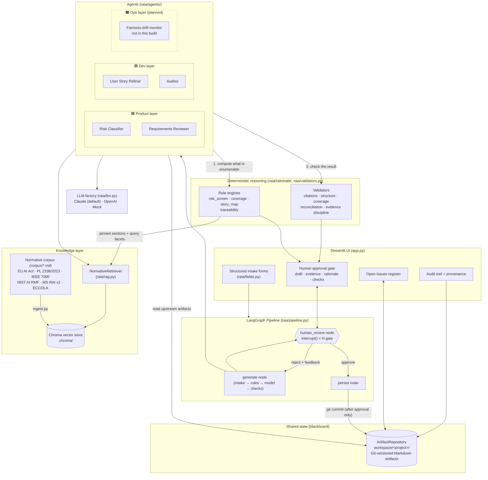

## 1b. The Agent Turn (where the reasoning happens)

Every agent runs the same five-step turn. Steps 1, 2 and 4 are deterministic;
only step 3 calls a model, and step 5 is a person. This is the generalisation
of the one place in the earliest version where a claim was enforced by code
rather than requested in a prompt.

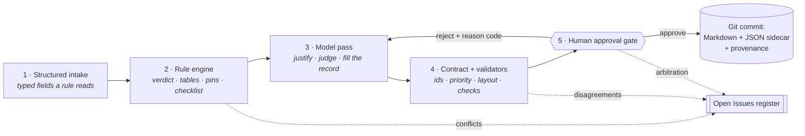

**The division of labour is the point.** Prohibition lists, high-risk area
lists, obligation tables, coverage matrices, traceability registers and metric
thresholds are enumerable, so they are computed. Whether a narrow-task
exemption really holds, whether a harm is significant, whether a lexical match
is real evidence — those are open-textured, so they are argued by the model and
settled by a person. Where the two disagree, neither wins silently: the
disagreement is recorded as an open issue.

**Every turn ends in the same record.** The model's reply is one JSON object
validated against the agent's schema (`raia/contract/`): a shared core —
summary, findings placed on likelihood and magnitude, actions, typed open
issues, declared coverage — and an extension shaped by the agent's normative
source. Not every stage fills the whole core: the Risk Classifier analyses
risk and writes no actions; the Requirements Reviewer answers the approved
risks with requirements and writes neither findings nor actions (each
requirement carries the risks behind its gap and their priority). Code
assigns the identifiers, computes risk level and priority, carries the
engine's issues forward, and renders each artifact's layout — the risks and
the decisions on them for the Risk Classifier; the requirements first for the
Requirements Reviewer; the refined stories first for the User Story Refiner;
an audit report, rated by code, for the Auditor — on screen
and in the document alike (`raia/contract/digest.py`). A reviewer edits the record's fields at the gate, never its prose.
The standard is specified in `docs/output-contract.md`.

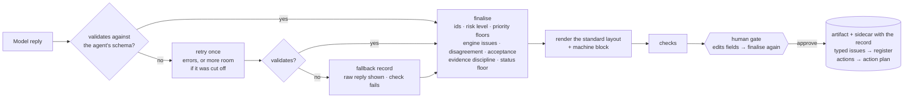

## 1b′. Interface: page map

The interface is a set of pages behind a top menu (`app.py` registers them with
`st.navigation`; the map is documented in `raia/ui/routes.py`).

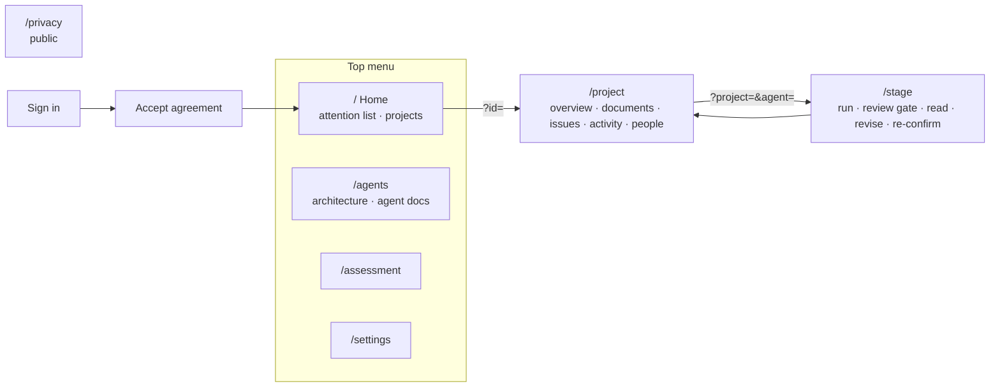

Project progress, including the *Needs review* flag, is derived on every load
by `raia/lineage.py` from the blackboard and the event log: an approved stage
needs review when a stage it depends on (through `upstream_keys`, transitively)
was approved after it was last approved or re-confirmed. Nothing is re-run.

## 1c. People, Projects and Storage

The blackboard belongs to a **project**, and a person reaches a project only
through a membership. Every project operation — reading, running an agent,
approving, arbitrating, inviting, exporting — goes through one authorization
check in `ProjectService`, below the UI.

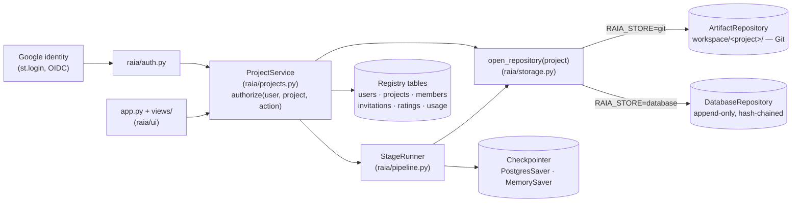

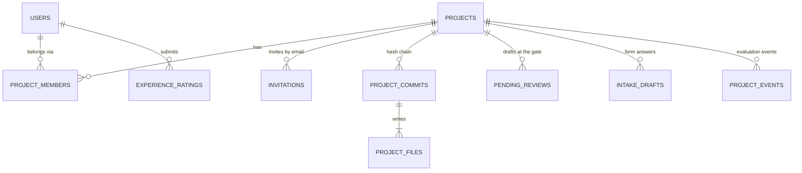

| Role | View | Run agents, edit answers | Approve / reject, arbitrate | Invite, settings, delete |
|---|---|---|---|---|
| owner | ✓ | ✓ | ✓ | ✓ |
| editor | ✓ | ✓ | ✓ | |
| reviewer | ✓ | | ✓ | |

Three rules the tests enforce:

- **Stage is derived, never stored.** A project's progress is computed from
  its approved artifacts and pending drafts on every read.
- **Identity comes from the session.** The approver recorded at a gate is the
  signed-in person; any approver name in the caller's payload is overwritten.
  With *require a second approver* set, the person who ran a stage cannot
  approve it — including after a restore.
- **History is tamper-evident on both backends.** Git objects locally; in the
  database each version's digest covers its parent digest, its message, its
  timestamp and the SHA-256 of every file it wrote, and `verify_history()`
  recomputes all of them.

## 1d. The sprint cycle: backlog, sprints and roadmap

Once the risk classification and the ethical requirements are approved, a
project runs as a loop of sprints over one backlog. Requirements are
constants; the work they need is spread over many sprints. There are still
four agents: the backlog, the sprints and the roadmap are **shared state on the
blackboard**, not an agent, and people plan the sprints.

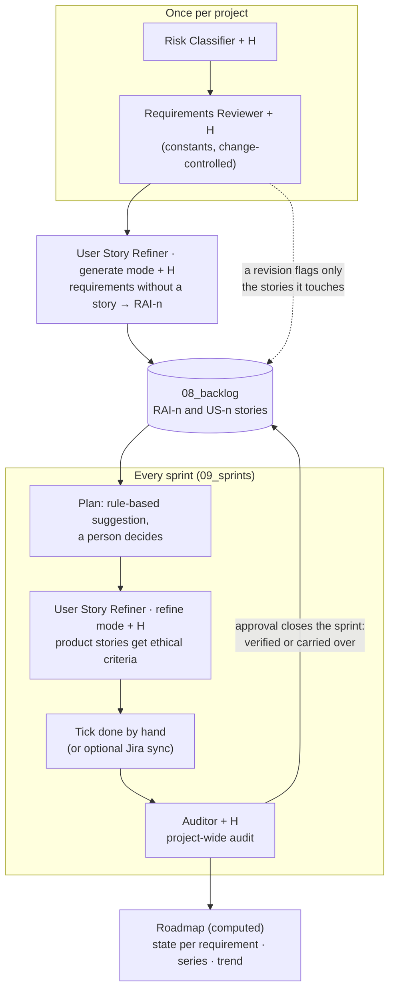

| Piece | Where | Rule |
|---|---|---|
| Backlog register | `raia/backlog.py`, `08_backlog.md` + `.json` | Stable ids (`RAI-n` from requirements, `US-n` product). An RAI story links at least one requirement. Statuses: backlog, in sprint, done, verified, needs review, obsolete |
| Sprints register | `raia/backlog.py`, `09_sprints.md` + `.json` | One open sprint at a time: planning → active → awaiting audit → closed. It closes only on an approved audit, which records its numbers |
| Per-sprint copies | `04_refined_stories.SPR-n.md`, `05_audit_report.SPR-n.md` | The same commit as the approval that wrote them |
| Roadmap | `raia/roadmap.py` | Computed, never generated: where each requirement stands, verified requirements per sprint, the trend, the sprints-left estimate, and the next-sprint suggestion (rules only, no model) |
| Generate mode | `raia/agents/story_generate.py`, `raia/rationale/story_seed.py` | A mode of the User Story Refiner with its own record. Short list by default (five), widened on request |
| Project-wide audit | `raia/rationale/traceability.py`, `raia/rationale/backlog_coverage.py` | This sprint's items audited; the rest reported where it stands; the backlog checked against the ethical risks |
| Change control | `backlog.compare_requirements`, `backlog.change_control` | A changed requirement flags its stories; a removed one proposes obsolete; the stages of the sprint cycle are never flagged wholesale (`lineage.CYCLIC`) |
| Jira (optional) | `raia/jira.py`, `raia/ui/jira_panel.py` | CSV with no setup; push and sync with a person's own token. Done in Jira means delivered; a sync never overwrites a manual change and never verifies |

Who may do what on the board: owners and editors add stories, plan, start and
end sprints and push to Jira; every member, reviewers included, can tick a
story done and sync from Jira. Only an approved Auditor run sets a story
verified.

## 1e. The review loop and the hand-off between stages

Every stage page runs the same loop, and what a person decides in it travels to
the next stage through the blackboard — never through a call between agents.

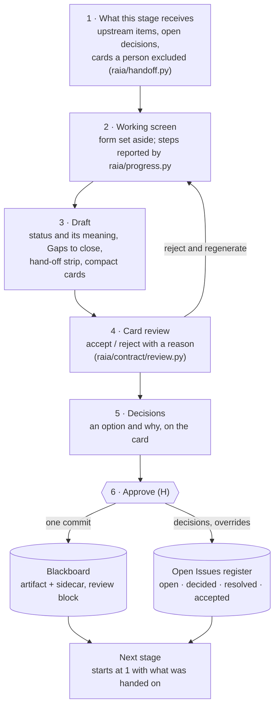

- **Card review.** A rejected card the model wrote leaves the approved record
  and is kept in its `review.rejected` block with who and why. A rejected card
  a rule engine computed (an ethical value requirement exists because the
  coverage matrix found a gap) is kept, marked `overridden`, recorded in the
  register as a decided disagreement with code, and not handed on: no story is
  generated for it and it is not audited. Unmarked cards are accepted.
- **Decisions.** Each open issue carries options (the engine's, the agent's, or
  a default per issue type). On a draft, a decision is kept with the pending
  draft and reaches the register already decided on approval; on an approved
  record it is written to the register at once. A decision is identified by
  its wording, so renumbering cannot lose it.
- **Status.** A record is *Blocked in its current form* when anything in it is
  blocking. The status shown is derived, like stage staleness: once every
  blocking decision is taken it reads as needing attention, and says which
  decision lifted it. The committed record is never rewritten.
- **Hand-off.** Items are tracked on identifiers code assigns and keeps across
  stages — obligation codes, `EVR-n`, story ids, audit item ids — never on
  per-record ids such as `RC-F1`. The next agent's prompt lists the decisions
  people took and the items they excluded upstream. The project's
  Traceability tab draws the whole thread, obligation → requirement → story →
  audit verdict.
- **Checks.** Every check still runs and is persisted. Each check code has an
  audience (`raia.validators.CHECKS`): the reviewer is asked to act only where a
  person is needed; what code already corrected (a fabricated citation is
  removed, an upgraded verdict restored) goes to the technical log.

## 2. Class Diagram (code structure)

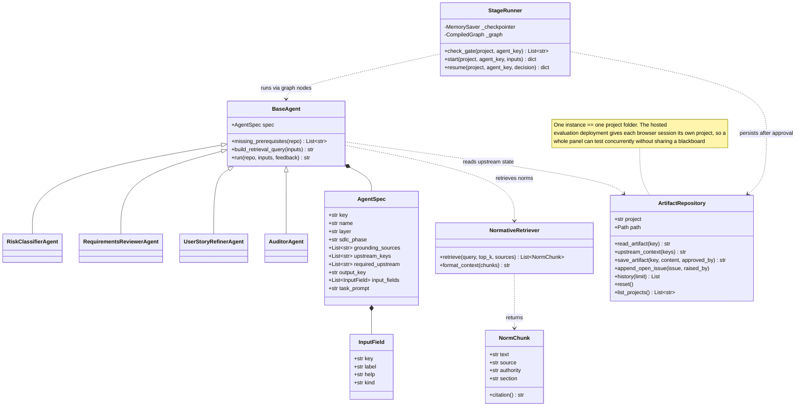

## 3. Sequence Diagram (one agent run with the human checkpoint)

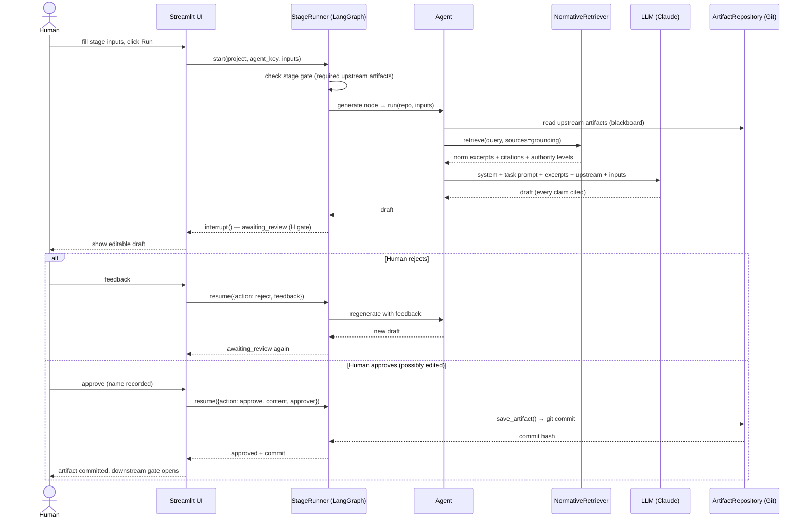

## 4. Pipeline / State Diagram (SDLC-wide stage gates)

Agents never trigger each other; a stage only unlocks when the human has
approved the upstream artifact it requires.

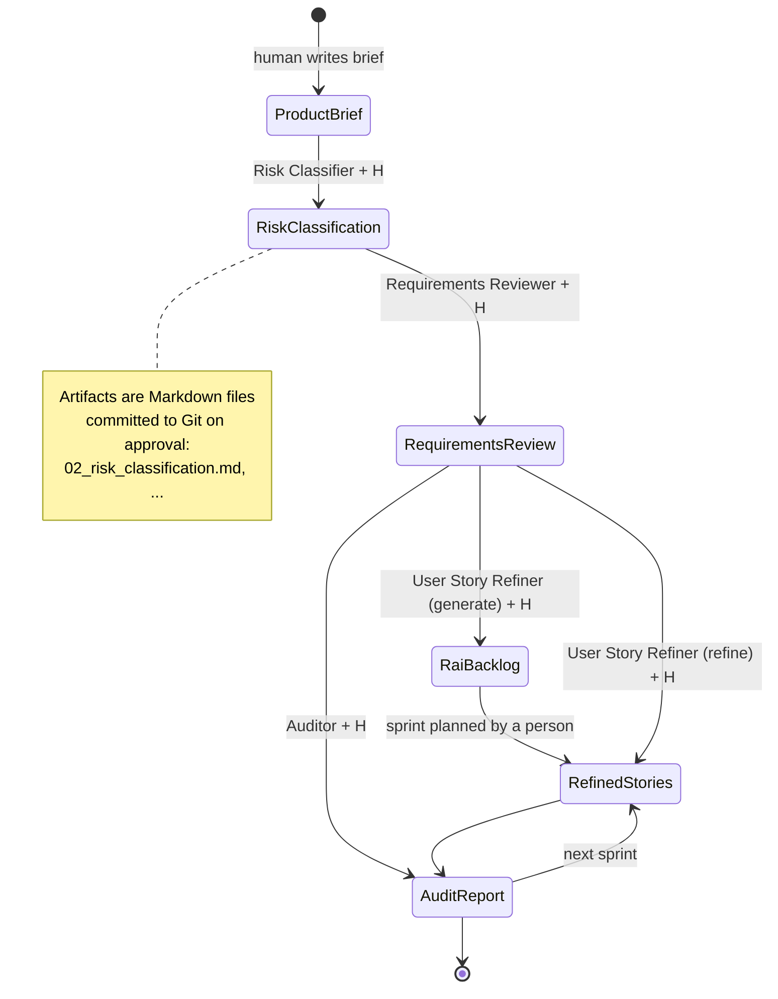

## 5. Design Decisions (traceability to the RAIA architecture)

| Architecture element | Implementation | Enforced by |
|---|---|---|
| Agents in layers | `raia/agents/` — one module per agent; `AGENTS` registry in pipeline order. Product and Dev layers run; the Ops layer is specified and not implemented in this build | structure |
| Blackboard per project, versioned | `raia/repository.py` (Git) and `raia/storage.py` (hash-chained database); every approval is one recorded version carrying the Markdown artifact *and* its JSON sidecar; approval provenance stamped in the header | code |
| Mandatory human checkpoints "H" | `interrupt()` in the `human_review` node; the persist node is unreachable without an approve decision, including on the restart-recovery path | code + smoke test |
| Agents never trigger agents | stage gates via `AgentSpec.required_upstream`; no agent-to-agent call exists | structure |
| Grounded recommendations | `raia/rag.py` — excerpts carry source, section, authority and a stable id; agents must cite them | prompt |
| Citations are real | `validators.check_citations` matches every tag against the excerpts actually retrieved for that run; `assemble.finalize` removes a tag that resolves to none and records the removal (`pruned_citations`, `PRUNED_CITATION` notes in provenance) | code + smoke test |
| The decisive excerpt is never missing | each decision procedure declares `Pin`s, fetched by exact metadata match and merged ahead of similarity results | code + smoke test |
| Decision procedures, not prompts | `raia/rationale/` — one rule engine per agent computes the verdict, the tables and the identifiers before any model call | code |
| Verdicts are reconciled, not averaged | `validators.check_reconciliation` requires the agent to declare agreement or disagreement; disagreement becomes an open issue | code |
| Conflict precedence legal > standard > advisory | `config.AUTHORITY_LEVELS`, reinforced by excerpt ordering in the prompt | prompt |
| Same-level conflicts escalated | `ArtifactRepository.append_open_issues` — a tracked register with statuses, populated from both the engine and the approved draft | code |
| Declared completeness | each engine emits a checklist; `validators.check_coverage` requires a status per key | code |
| Anti-ethics-washing audit | `rationale/traceability.py` assigns NOT VERIFIED where no evidence exists; `validators.check_forbidden_verdicts` prevents an upgrade | code |
| One standard output for every agent | `raia/contract/` — schema per agent (shared core + extension), closed vocabularies from the normative sources, code-computed identifiers, risk level and priority, one rendered layout, bounded repair and an honest fallback; published in `docs/schema/` and `docs/output-contract.md` | code + test_contract |
| Every identified risk is responded to | `contract.checks.check_responses` — every finding has an action or an open issue; accepting a risk opens an issue. The Risk Classifier hands its risks on; the Requirements Reviewer answers them with requirements, one per gap, each naming the risks it answers | code |
| Structured human editing | the gate edits record fields; persistence re-finalises, re-renders and re-validates what was approved; free-text edits are refused | code + smoke test |
| Project action plan | `contract.actions` — every action from every approved record, sorted by computed priority, exported as CSV/JSON | code |
| Reproducible audit trail | `raia/provenance.py` — model, temperature, corpus version, excerpt ids, prompt hash, attempt, edits, rejection history, check results | code |
| Data protection | projects are reachable only through a membership, checked in `ProjectService.authorize`; sign-in delegated to Google (no stored passwords); research exports pseudonymized with keyed participant codes; no retraining | code + test_projects |
| Accountable approval | the approver is the authenticated identity; optional second-approver rule makes the runner ineligible to approve | code + test_projects |
| Durable review state | `PostgresSaver` checkpointer and stored drafts; a restored review re-enters the gate | code + test_projects |
| Input sanitization | `raia/sanitize.py` — control characters, length caps, injection patterns in English and Portuguese; applied to form input *and* to the approved artifact | code |
| Provider-agnostic LLM | `raia/llm.py` factory and a single `invoke_chat` call site | structure |
| Iterative development across sprints | a backlog and sprints on the blackboard (`raia/backlog.py`); the Refiner's generate and refine modes write to it only through their gates; the roadmap and the sprint suggestion are computed (`raia/roadmap.py`) | code + test_backlog |
| The audit covers the whole project | `traceability.run` audits the sprint's items and reports the rest where it stands; `backlog_coverage` checks the backlog against the ethical risks; progress and trend are computed from the final verdicts | code + test_backlog |
| A person reviews each card | `contract.review` — accept or reject per card with a reason; a rejected model card leaves the record into its review block, a rejected computed card is kept as an override and recorded in the register | code + test_contract, test_ui |
| Decisions are taken where they are raised | the decision card writes to the pending draft, then the register on approval (`append_open_issues` with a decision), or to the register directly on an approved record (`ProjectService.decide_issue`); a `decided` status | code + smoke test, test_ui |
| Stages hand on, visibly | `raia/handoff.py` — what each stage receives and addresses on stable identifiers, what changed since the approved version, the Traceability thread, and the decisions and exclusions the next prompt is told about | code + test_backlog |
| Only an audit verifies | `backlog.apply_audit` runs only on an approved audit of an ended sprint; ticks and Jira syncs set *done*, never *verified* | code + test_backlog, test_jira |

**Not yet implemented** (tracked in the README roadmap): the Ops layer (a
fairness-drift monitor fed by production telemetry), ingesting the official
legal texts with article-level citation metadata, Confluence, Jira Server or
Data Center (Jira Cloud is supported, optionally), and least-privilege
tool-permission hardening.

**Known limitations, stated plainly.** The corpus is a set of curated summaries
prepared for this project, so a citation resolves to a section of a summary
rather than to the official wording; sources in `config.DERIVED_SOURCES` are
labelled as such in the prompt and at the approval gate. Injection detection is
regex-based and will not catch a careful paraphrase — the controls that carry
the weight are the approval gate and the citation validator, not the pattern
list. The lexical matchers in the coverage and traceability engines are
deliberately coarse and conservative: they produce candidate gaps and
conservative verdicts for a human to review, and are not evidence of absence.
